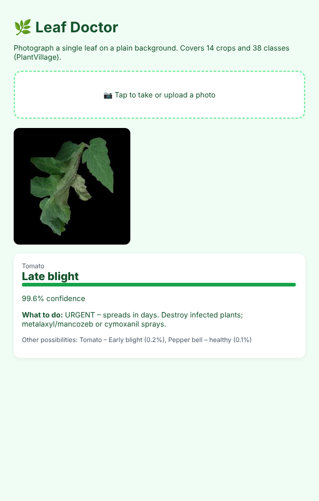
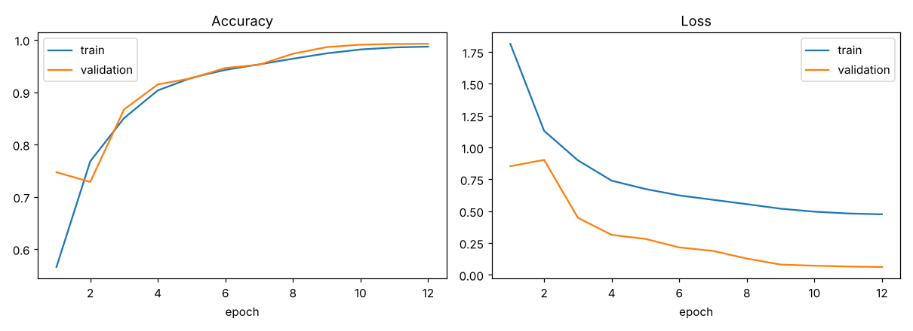
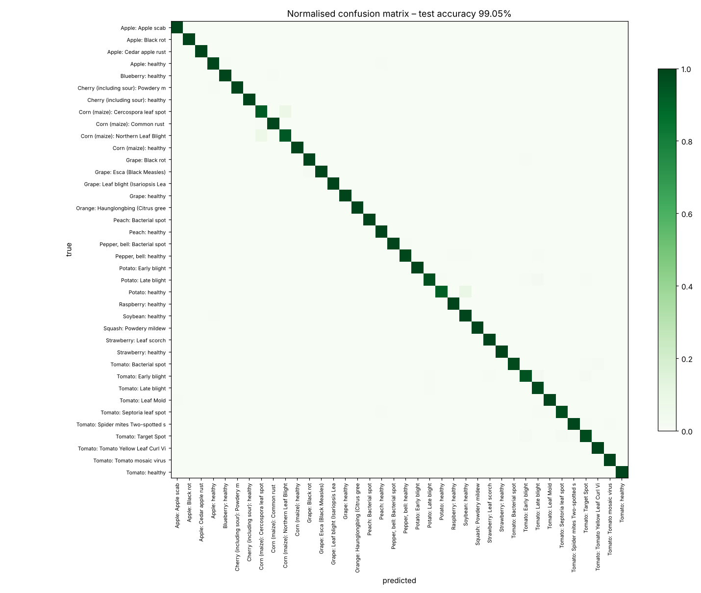

# Plant Disease Detection with a CNN: 38 Classes, 99.05% Test Accuracy

[](https://github.com/Drakeion2532/plant-disease-detection-cnn/actions/workflows/tests.yml)

This project identifies **26 diseases across 14 crops** (38 classes including healthy leaves) from a single leaf photo. It then tells the farmer **what to do next**. The repo includes a training pipeline, an evaluation report, a CLI predictor and a mobile-friendly web app.

It is my from-scratch PyTorch re-implementation of **M. Chohan, A. Khan, R. Chohan, S. H. Katpar, M. S. Mahar, "Plant Disease Detection using Deep Learning", *IJRTE* 9(1), 2020** ([DOI 10.35940/ijrte.A2139.059120](https://doi.org/10.35940/ijrte.A2139.059120)). The paper reports **98.3%** test accuracy, and this replication reaches **99.05%** on a 15% held-out test set while training on a 2-core CPU.

| Web app | Training curves |
|---|---|
|  |  |

## Why it matters

Pests and plant diseases cost an estimated 20–40% of global crop production each year (FAO). In India, a smallholder farmer often waits days for an agronomist, while late blight can wipe out a tomato field in under a week. A phone photo plus an instant diagnosis and first-response advice shortens that gap.

## Results (8,146 unseen test images)

| Metric | Value |
|---|---|
| **Accuracy** | **99.05%** (paper: 98.3%) |
| Top-3 accuracy | 99.99% |
| Macro F1 | 0.986 |
| Weighted F1 | 0.991 |
| Parameters | 1.58 M (5 MB model) |

**Hardest classes (F1):** corn Cercospora/grey leaf spot 0.89 (it is visually close to northern leaf blight), healthy potato 0.93 (only 152 images in the whole dataset), corn northern leaf blight 0.95, tomato early blight 0.95 and potato late blight 0.97. Per-class scores are in [`results/test_metrics.json`](results/test_metrics.json).



> Training loss sits above validation loss because training uses label smoothing (0.05) and heavy augmentation, while validation sees clean images. This is expected and is not a sign of under-fitting.

## Method (following the paper)

| | Paper | This implementation |
|---|---|---|
| Dataset | PlantVillage, 38 classes | PlantVillage colour set: 54,305 images, 38 classes |
| Split | test 15% | stratified 70 / 15 / 15 train / val / test (seed 42) |
| Augmentation | yes | flips, 90° rotations, brightness/contrast jitter |
| Network | 5 × (Conv 3×3 → MaxPool 2×2) + BatchNorm + Dense | 5 × (Conv 3×3 → BN → ReLU → MaxPool) widths 32-64-128-256-256 → Dropout → Dense 256 → 38 |
| Input | 256×256 | 64×64 (CPU budget; pass `--size 256` on a GPU) |
| Optimiser | Adam | AdamW + one-cycle LR, label smoothing 0.05, 12 epochs |
| Inference | – | test-time augmentation (average of 4 rotations) |

Each prediction comes with **farmer-facing guidance** (`plantdoc/advice.py`), for example *"Late blight: URGENT – spreads in days. Destroy infected plants; metalaxyl/mancozeb sprays."*

## Run it

```bash
pip install -r requirements.txt

# try it immediately with the trained model + sample leaves
python -m plantdoc.predict data/sample/Tomato___Late_blight/*
uvicorn app.app:app --port 8004            # web app at http://127.0.0.1:8004

# reproduce training (~1.7 GB download, ~45 min on 2 CPU cores, a few minutes on a GPU)
bash scripts/download_plantvillage.sh data/plantvillage
python -m plantdoc.preprocess --src data/plantvillage/raw/color --out data/cache --size 64
python -m plantdoc.train --cache data/cache --epochs 12
python -m plantdoc.report
pytest -q
```

## Data

* **PlantVillage** (Hughes & Salathé, 2015), mirrored at [spMohanty/PlantVillage-Dataset](https://github.com/spMohanty/PlantVillage-Dataset). The download script fetches only `raw/color` with a sparse clone.
* `data/sample/`: 2 images per class (76 total) for quick demos. These may overlap the training set, so use the test split for evaluation.

## Limitations and next steps

* **The 99% is a lab number.** PlantVillage photos are single leaves on plain backgrounds, and many images were taken under near-identical conditions, so a random split rewards learning the setup as much as the disease. The original PlantVillage study (Mohanty et al., 2016) found accuracy fell to about 31% on images from other sources. Treat 99.05% as "the pipeline works", not as field accuracy. The next step is fine-tuning on [PlantDoc](https://github.com/pratikkayal/PlantDoc-Dataset) field images.
* Add a "not a leaf / unknown crop" rejection class (the paper's suggested 3-stage pipeline).
* Export to ONNX / TFLite for offline use on low-end Android phones.

## Structure

```
plantdoc/
  preprocess.py   resize + cache images as numpy
  model.py        the 5-block CNN
  train.py        training loop, augmentation, split
  report.py       metrics, confusion matrix, curves
  predict.py      CLI / library predictor with TTA
  advice.py       treatment guidance per disease
app/              FastAPI web app (upload or camera)
results/          trained weights (plant_cnn.pt), metrics, figures
scripts/          dataset download
```
